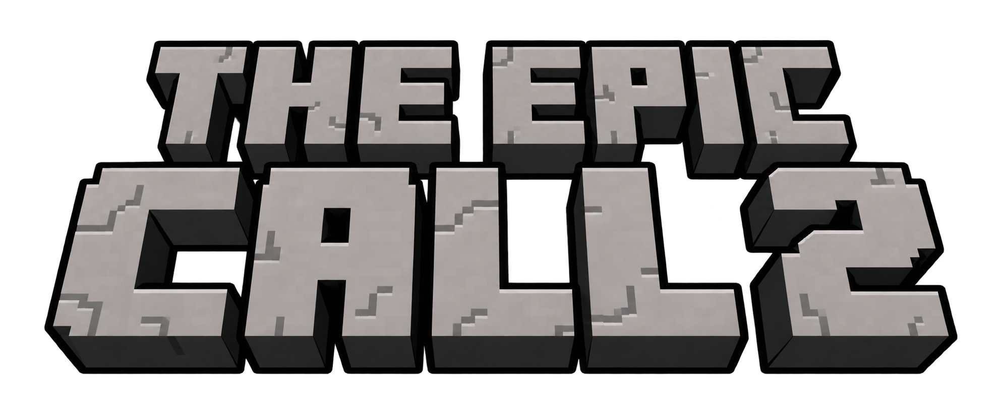
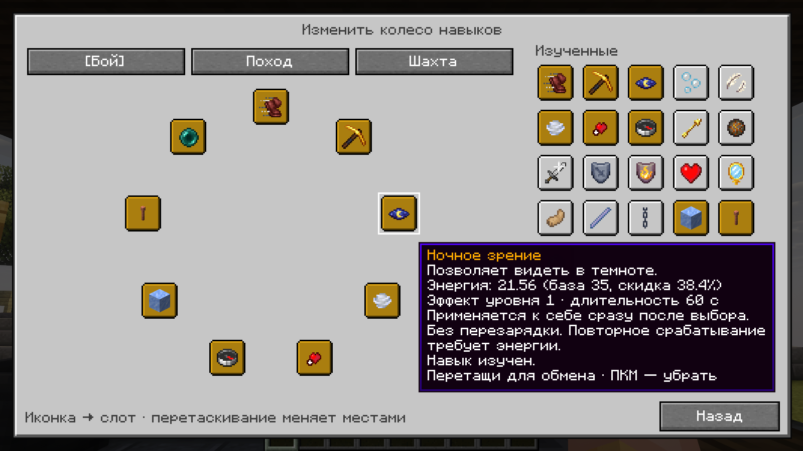
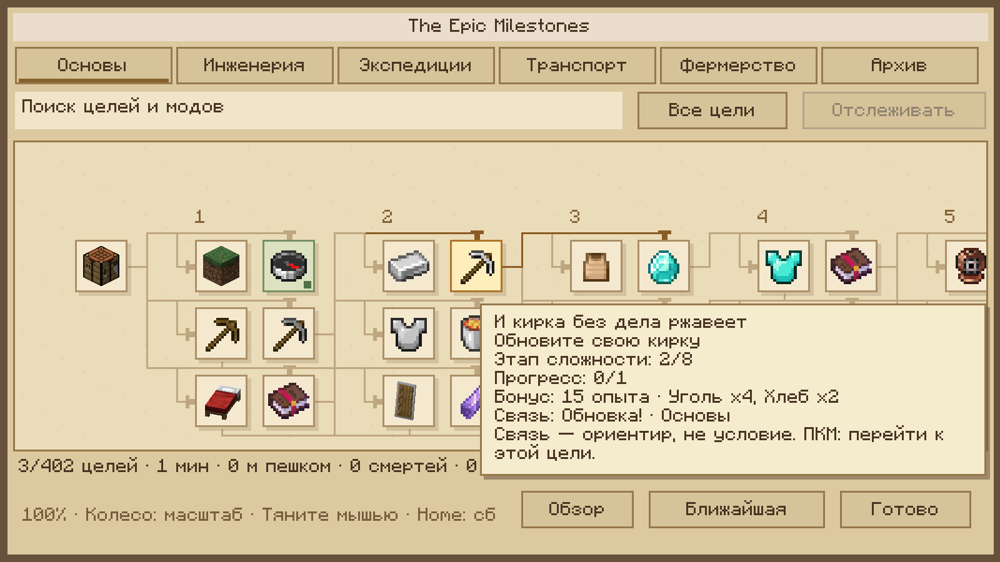

  

<h1 align="center">The Epic Call 2.5.0</h1>

**The Epic Call 2.5.0 опубликована по прямой ссылке; stable пока остаётся на 2.4.0.** Публичные загрузки и тестовый маршрут проверены. Обычный Helper начнёт предлагать 2.5.0 после отдельного принятия её оставшихся ограничений и переключения канала. Новый Setup сам канал не переключает и установку сборки автоматически не запускает.

[Выпуск 2.5.0 и ограничения](https://github.com/Pliestt/the-epic-call-2/releases/tag/pack-2.5.0) · [Setup 1.2.3](https://github.com/Pliestt/the-epic-call-2/releases/download/pack-2.5.0/The.Epic.Setup.exe) · [Helper 1.14.1](https://github.com/Pliestt/the-epic-call-2/releases/download/pack-2.5.0/The.Epic.Helper.exe)

В 2.5.0: животные Naturalist, броня Fantasy Armor и аксессуары Accents, готовые меню FancyMenu/загрузка Drippy, русская локализация и исправления EMF/Veil/IPN/холодного preview. Прежние экипировка, личные настройки, Rank/Rid/Milestones и единое окно аксессуаров сохраняются.

Два клиента/другой ПК/dedicated и редкие игровые условия ещё не проверены. Watchdog Streams при дальней генерации наблюдался; подтверждённого deadlock нет. Это ограничения именно 2.5.0, не перенесённая отсрочка 2.4.0.

<strong>Мастерские. Дальние дороги. Собственная магия.</strong> 
Мир, в котором хочется построить дом — и всегда есть причина отправиться дальше.

  
  
  
  
  

  
  
  

<a href="#user-content-world">О сборке</a> · <a href="#user-content-epic-mods">Наши моды</a> · <a href="#user-content-install">Установка</a> · <a href="https://github.com/Pliestt/the-epic-call-2/releases/tag/pack-2.5.0">Что нового</a> · <a href="#user-content-faq">Вопросы</a>

   
  Terralith · Stardust Labs · <a href="https://modrinth.com/mod/terralith/gallery">официальная галерея</a>

## Один мир — много собственных историй

Сначала здесь будет только берег и место для первого костра. Через несколько вечеров у воды закрутится колесо, за лесом появится станция, а на карте — дорога к руинам, куда вы решили вернуться уже всей компанией.

**The Epic Call** соединяет исследование, видимые механизмы Create, уютное строительство и нашу магию Rid. Можно посвятить вечер мастерской, уйти в экспедицию или собрать друзей за общим столом. Каждое занятие оставляет что-то нужное другим: припасы, материалы, новый маршрут или историю, которую потом будут вспоминать на базе.

<table>
<tr>
<td width="33%" valign="top"><strong>Исследовать</strong>  Рельеф Terralith, сооружения YUNG’s, Dungeons and Taverns, холодные воды Aquamirae, глубины Deeper and Darker и небесный The Aether.</td>
<td width="33%" valign="top"><strong>Создавать</strong>  Мастерские Create, фермы, поезда, торговые площадки, варка зелий миксером и опасные ядерные реакторы.</td>
<td width="33%" valign="top"><strong>Обживать</strong>  Кухня Farmer’s Delight, детали Supplementaries, фотографии Exposure и собственная библиотека находок.</td>
</tr>
</table>

### Когда хочется, чтобы двигался сам проект

От первого водяного колеса до большой мастерской — здесь приятно видеть, как работает ваша идея. Валы передают вращение, ленты связывают этапы производства, а железная дорога превращает далёкие базы в соседние станции. Дополнения Create дают новые детали для инженерных задач; Aeronautics приглашает попробовать конструкции, которым тесно стоять на месте.

   
  Cloud Skipper · Create Aeronautics / Simulated · <a href="https://modrinth.com/mod/create-aeronautics/gallery">официальная галерея</a>

### Дом, в который возвращаются

У хорошей базы есть свой ритм: урожай на грядках, запас еды перед походом, свет в окнах и свободное место для трофея. Farmer’s Delight делает кухню полноценным занятием, строительные мелочи помогают придать дому характер, а Exposure позволяет сохранить момент, ради которого вы остановились посреди дороги.

   
  Kitchenware · Farmer’s Delight / vectorwing · <a href="https://modrinth.com/mod/farmers-delight/gallery">официальная галерея</a>

### За поворотом — ещё одна причина свернуть

Руины, подземные залы и необычные измерения дают экспедициям продолжение. Отмечайте входы в Xaero, готовьте припасы и выбирайте собственный темп: осмотреть ближайшую долину или уйти так далеко, чтобы обратная дорога стала отдельным приключением.

   
  YUNG’s Better Strongholds · YUNG-GANG · <a href="https://modrinth.com/mod/yungs-better-strongholds/gallery">официальная галерея</a>

## Своя магия. Общая система.

**The Epic Rid** — наша собственная магическая система: изучение навыков, запас энергии, развитие Контроля, пассивные способности и колесо заклинаний. Магия помогает в бою, путешествии и обычных делах; изученная телепортация связывает знакомые места. Вы выбираете набор под задачу и развиваете персонажа по ходу игры.

   
  Колесо навыков Rid · демонстрационный персонаж из книги «О сборке»

Rank считает только поддержанные проверяемые результаты; массовый крафт и атрибуция фабрик Create пока не входят в его охват.

### Десять модов The Epic

| Мод | Что добавляет в общий мир |
| :--- | :--- |
| **Rid** | Магию, развитие персонажа, активные и пассивные навыки, колесо заклинаний и телепортацию за энергию. |
| **Rank** | Единый рейтинг подтверждённых результатов мира, таблицу игроков и защиту от повторных начислений. |
| **Milestones** | Общий атлас достижений, тематические направления, отслеживание целей и награды. |
| **Automatic** | Настраиваемую АФК-рыбалку и медитацию для восстановления магической энергии. |
| **Graphics** | Четыре готовых режима графики и удобный доступ к настройкам; интерфейс администрирования для хоста. |
| **Map** | Оформление интерфейса Xaero в духе атласа и ограничения телепортации по правилам сборки. |
| **Locale** | Русские переводы и исправления локализации установленных модов и интерфейсов. |
| **Present** | Узнаваемое оформление меню и загрузки, приветствие и путеводитель по сборке. |
| **Updater** | Игровой экран проверки состава и переход к Helper для установки обновлений. |
| **Core** | Общую техническую основу: связь наших модов друг с другом и с Helper, серверные проверки и интеграции. |

   
  Атлас Milestones · демонстрационный интерфейс из книги «О сборке»

**The Epic Helper** сопровождает сборку за пределами игры: устанавливает и обновляет её через интернет или локальную сеть, помогает проверить файлы и разобраться с ошибками. Внутри него — большая иллюстрированная книга «О сборке» с галереей. Вход в аккаунт и запуск Minecraft остаются в вашем лаунчере.

## Начать играть — три шага

Пока stable не переключён, этот обычный маршрут устанавливает 2.4.0. После объявления переключения те же действия установят 2.5.0; переустанавливать лаунчер или заранее запускать ванильную 1.21.1 не нужно.

| Шаг | Что сделать |
| :--- | :--- |
| **01 · Подготовить** | Скачайте **[The Epic Setup](https://github.com/Pliestt/the-epic-call-2/releases/download/pack-2.5.0/The.Epic.Setup.exe)**, запустите его и выберите папку **`.minecraft`** своего лаунчера. Setup разместит Helper и откроет его. |
| **02 · Установить** | В Helper выберите **«Интернет»**, укажите свой лаунчер, проверьте источник и нажмите **«Установить сборку»**. Дождитесь завершения. |
| **03 · Отправиться в мир** | Откройте лаунчер и запустите созданную версию **`1.21.1 The Epic Call 2`**. При первом запуске лаунчер скачает Minecraft, Java и базовые ресурсы; затем автоматически подготовится NeoForge и откроется игра. |

**Заранее создавать и запускать обычную 1.21.1 не нужно.** Python и подключение к локальной сети автора тоже не требуются. Во время первой подготовки NeoForge оставьте окно открытым.

Windows 10/11 x64 · Setup 1.2.3 / .NET Framework 4.8 · Helper 1.14.1. Setup сам установку сборки не запускает: её начинаете вы в Helper.

## Перед первым вечером

Для друзей с 2.4.0 **после объявления переключения stable**: закрыть игру → Helper → «Обновления» → «Интернет» → сначала Helper 1.14.1, затем сборка 2.5.0. Сохранение личных конфигов не мешает доставке готовой темы. Перед открытием своего мира сохраните полную резервную копию; `.epic` не удаляйте.

<strong>Сборка уже установлена через локальную сеть. Что делать?</strong>

Переустанавливать её не нужно. Закройте Helper, [скачайте актуальный EXE](https://github.com/Pliestt/the-epic-call-2/releases/download/pack-2.5.0/The.Epic.Helper.exe) и замените `The Epic Helper.exe` в папке установленной версии. Откройте «Обновления», выберите **«Интернет»** и проверьте выпуск. Если интернет-источник уже доступен, обновить приложение можно на вкладке «Обновить Helper».

При смене источника игровой состав должен совпадать. Если установленная LAN-версия старее публичной 2.4.0, сначала получите 2.4.0 через прежнюю LAN-раздачу, затем переключитесь на интернет. Замена Helper не отменяет эту проверку. Не удаляйте `.epic/installation.json` для обхода защиты.

<strong>Нужен свой лаунчер? А что с аккаунтом?</strong>

Да, используйте свой установленный лаунчер. Helper создаёт стандартную папку версии для официального Minecraft Launcher и TLauncher; авторизация остаётся в лаунчере. Prism использует отдельные экземпляры; проверенного маршрута получения полного состава, выбора root и запуска через Helper пока нет. Не копируйте Helper в папку экземпляра: это не выбирает её для управления. Полного переносимого архива 133 модов в Releases нет; авторский bundle содержит только десять наших JAR и ресурсы интернет-установки.

<strong>Что выбрать на менее мощном ПК?</strong>

В настройках игры есть четыре режима The Epic Graphics. Начните с более лёгкого и оцените игру на своей базе. Профиль **«Максимум FPS»** отключает шейдеры и Distant Horizons; остальные подбирают дальность и визуальные параметры. Настройки можно изменить вручную или вернуть свои значения.

<strong>Как получать следующие обновления?</strong>

Откройте «Обновления» в Helper, выберите **«Интернет»** и проверьте доступный выпуск. Перед применением закройте игру. Helper проверяет подписи и контрольные суммы, сохраняет резервные копии управляемых файлов и поддерживает восстановление. Личные настройки по умолчанию сохраняются. Миры и карты не входят в публичные файлы выпуска.

---

### Авторы и иллюстрации

На странице использованы материалы книги «О сборке»: наш логотип, демонстрационные интерфейсы и изображения из официальных галерей установленных модов. Авторские иллюстрации показывают возможности соответствующих модов; конкретные постройки и пейзажи в вашей игре зависят от мира и ваших решений.

**Спасибо авторам всех 133 модов, шейдеров и библиотек сборки.** Источники изображений, авторство и сведения о лицензиях собраны в **[CREDITS.md](CREDITS.md)**. Сторонние файлы Helper получает из официальных источников; Euphoria создаётся патчером у игрока.

### Лицензия

Оригинальные тексты и разметка этого репозитория распространяются по **[MIT](LICENSE)**. © 2026 Pliestt.

Лицензия репозитория не изменяет условия отдельно опубликованных программ и модов (EXE/JAR). Minecraft, сторонние моды, шейдеры, библиотеки, изображения и логотипы сохраняют условия своих правообладателей; источники иллюстраций указаны в [CREDITS.md](CREDITS.md).

Публичный репозиторий готовых выпусков. Исходники разработки, аккаунты, миры и приватные ключи сюда не загружаются.
